A few years ago I started taking photos of discarded things I'd find while out on walks with my dog. Odds and ends would catch my eye because, unlike the Chicago suburb where I grew up, Durham is less fastidious about keeping its yards and sidewalks and streets clear of debris. Abandoned cars, school buses, mattresses, toys, dead trees — the skeletons of things with histories I'd never know. They intrigued me.

As I took more of these photos, often using film cameras, I began reflecting on my fascination with detritus. I spent time with photos by folks like [Robert Polidori](https://theincubator.live/2016/11/30/robert-polidori-after-the-flood-large-format-photographs-in-the-aftermath-of-hurricane-katrina/), who surveyed New Orleans in the aftermath of Katrina, [Arthur Tress](https://clampart.com/2004/04/dream-collector-30th-anniversary/#thumbnails), who has a knack for finding the macabre in the mundane, and [Helen Levitt](https://www.moma.org/artists/3520), whose street scenes of mid-century New York feel at once serendipitous and composed, exuberant and somber. I appreciated how they each draw out the tragedy and comedy of the world around them.

Not quite litter, I came to see discarded objects as kinds of temporary, accidental sculptures. A keyboard nestled in a bed frame, a basketball hoop woven into a pile of birch branches, a doll head placed precariously on the end of a leafless branch. We shape our world with the things we leave behind, for better or worse, but indelibly nonetheless.

I wanted to do something with the photos I'd been taking, so I put together a little book. The result is *Fallen Things*, a visual meditation on the uncanny, derelict beauty of the mundane world around us. Apart from clearing away a branch or two, none of these images are staged; they're all things I've found while walking around Durham and traveling the south and midwest.

The book is 82 pages, perfect bound and printed locally in Durham on 100lb Mohawk photo paper. A majority of the images were taken on black and white medium format film, which I processed, scanned, and edited. Each copy of the book comes with a little set of birch leaves hand-stamped on the title page. Limited to 100 copies.

[Buy a copy](https://www.etsy.com/listing/1165927841/fallen-things-photo-book)

<iframe src="https://www.youtube-nocookie.com/embed/pr4YmfaS2Ew" title="Fallen Things photo book flip-through" allow="accelerometer; autoplay; clipboard-write; encrypted-media; gyroscope; picture-in-picture" allowfullscreen></iframe>

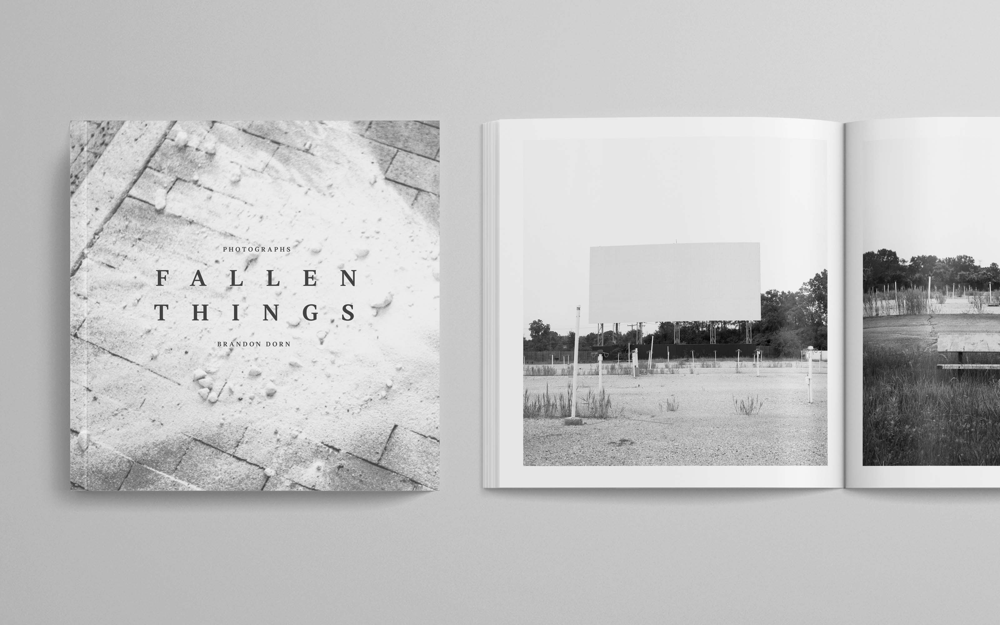

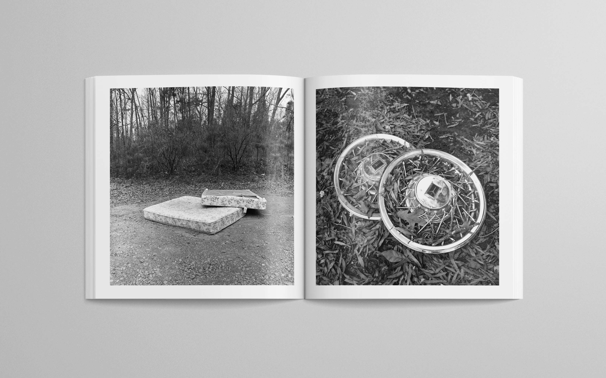

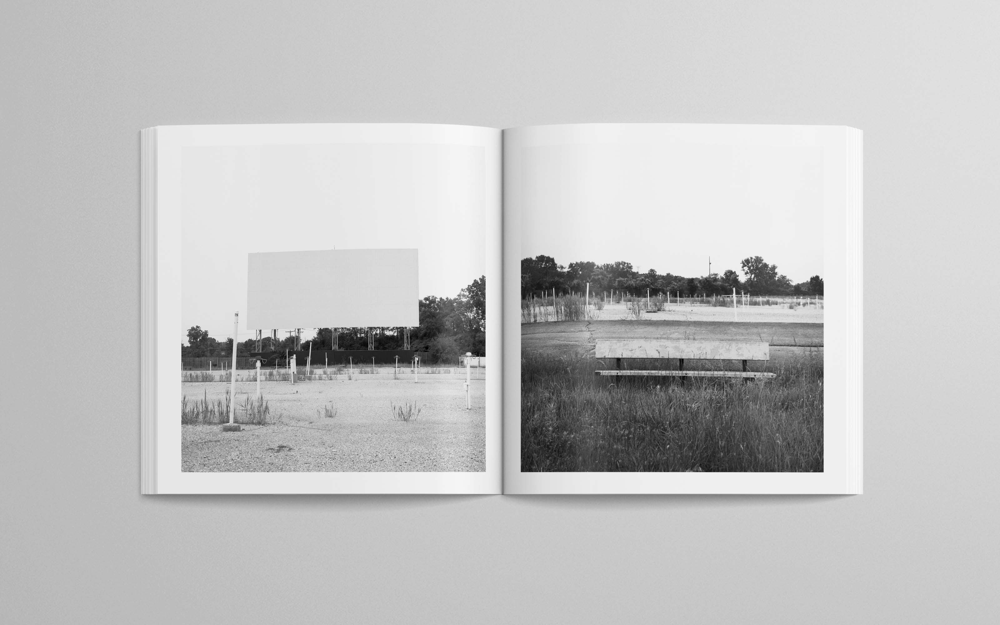

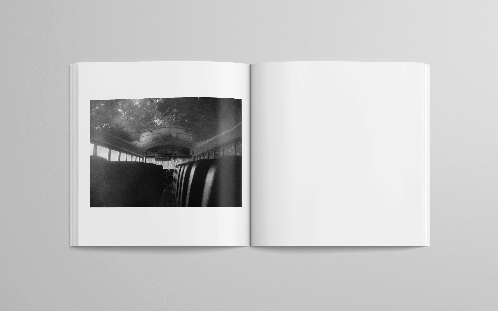

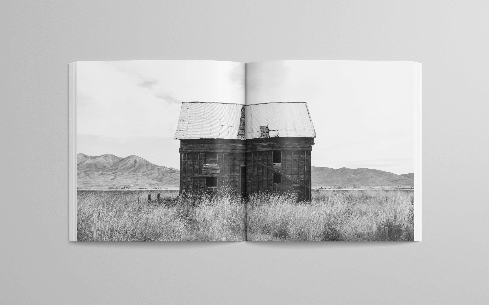

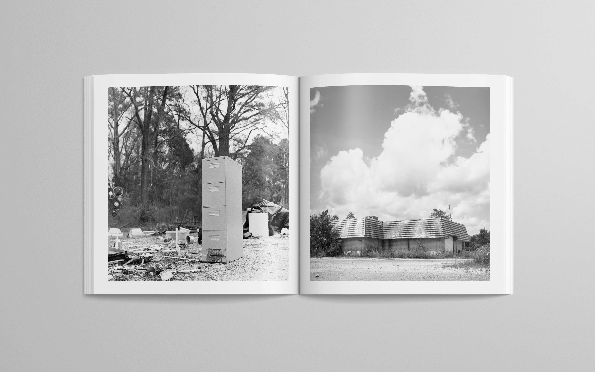

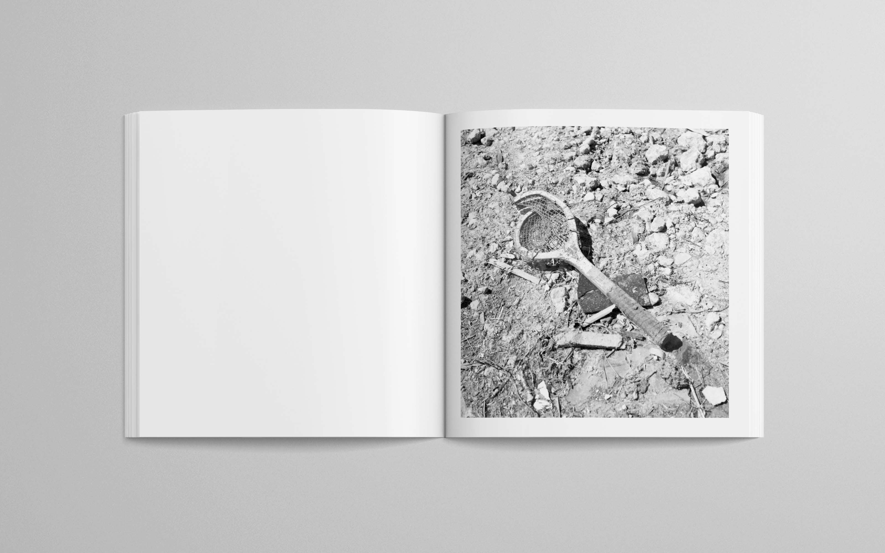

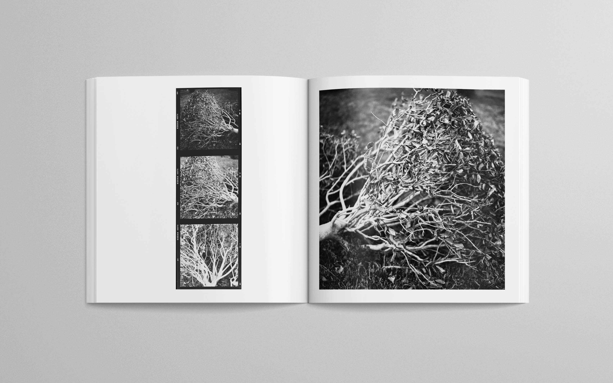

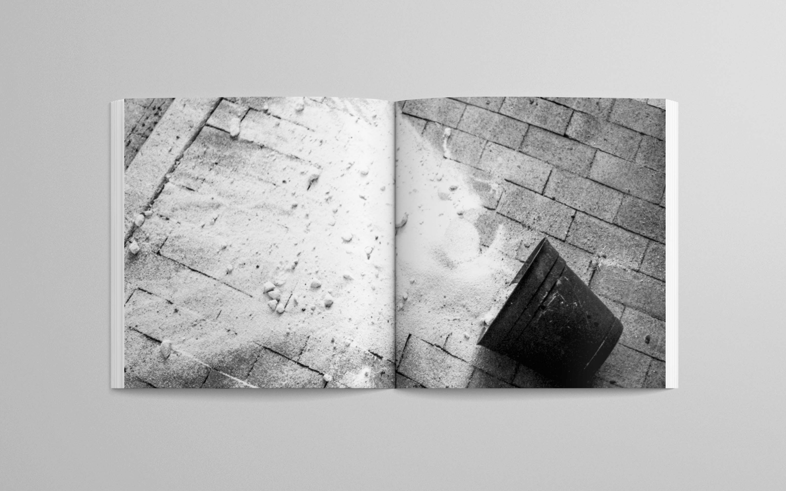

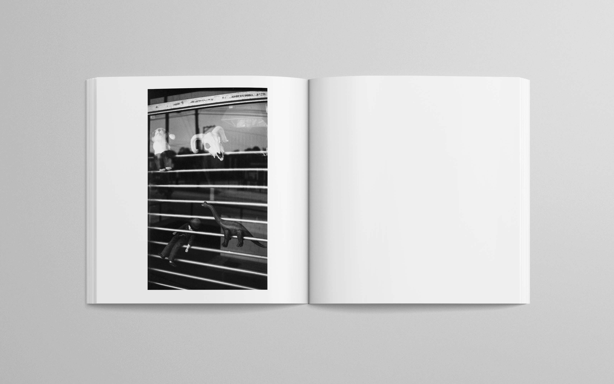

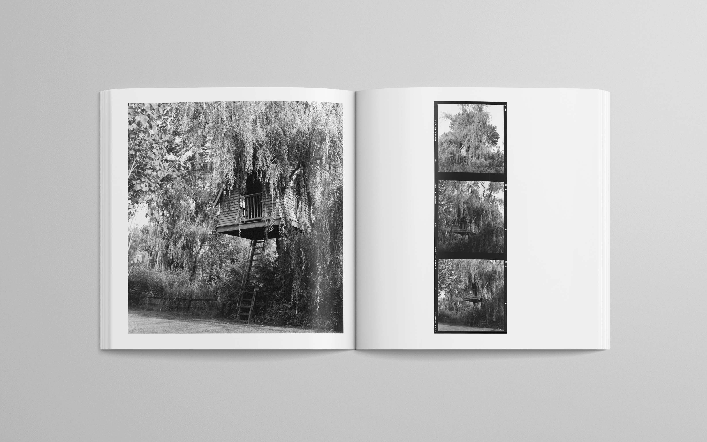

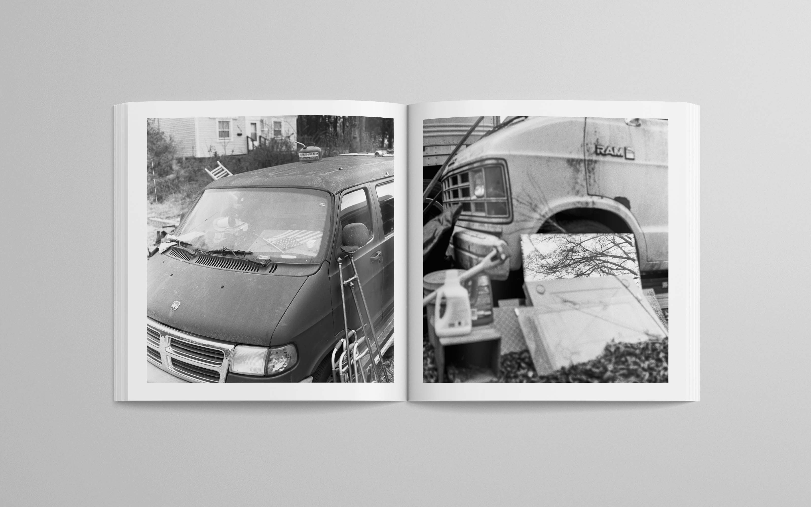

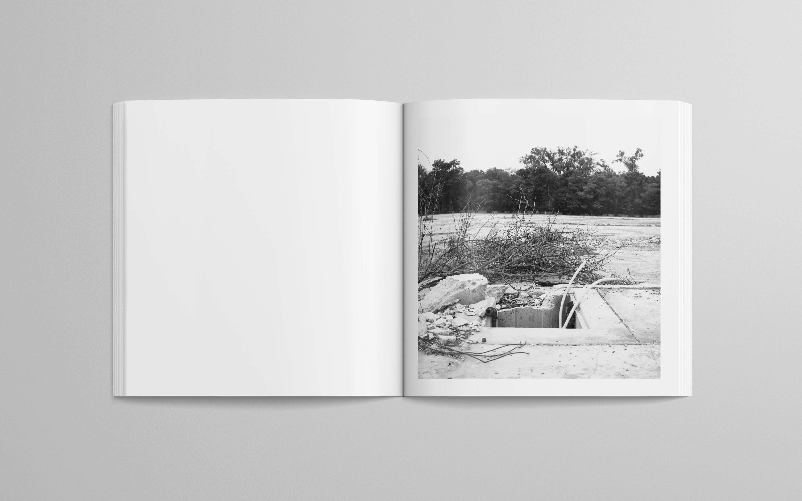

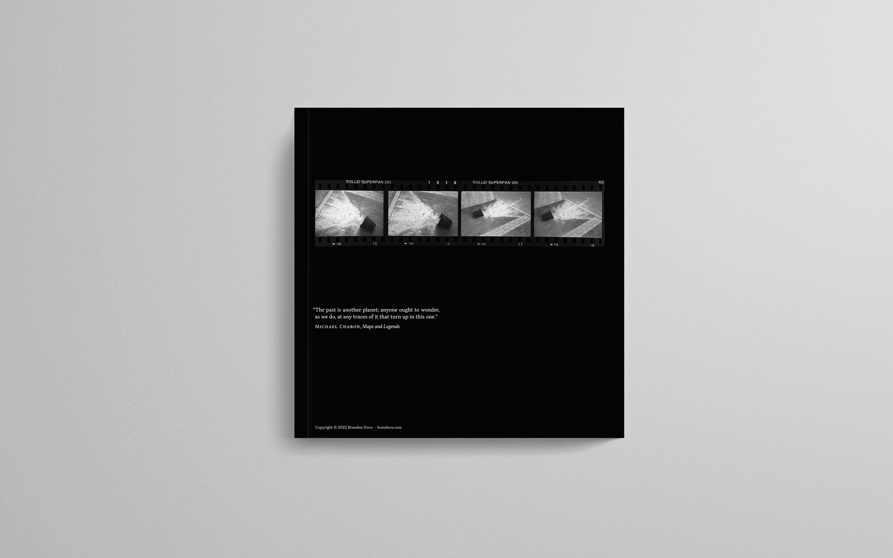
